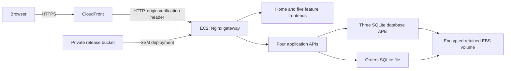

# Release 2 AWS deployment

Current source/configuration describes the existing five features and their CRUD APIs on one EC2 host in `ap-southeast-2`. The local Release 1 Compose layout remains available. Ollama, MCP, RAG and Multi-Agent are disabled in the cloud configuration.



Current status (21 October 2026): main `5ac7535` is deployed through the automatic
GitHub PUSH relay, temporary runner and native Actions job. All five student
workflows, seven suites, image build, gate and SSM acceptance pass. The public
Support deletion redirect is verified in Chrome. [Native deployment, persistence
and browser evidence](../evidence/release2-aws/final-5ac7535/verification.json).
The AWS plan is unchanged; Ethan requested keeping the demo running for marking.
Security findings and the separate human release decision remain in the [ledger](../evidence/release2-ethan-goldman/progress.md).

## Design choices

- One public HTTPS origin gives all features a shared secure session cookie. Paths are `/catalogue/`, `/inventory/`, `/account/`, `/orders/` and `/support/`.
- `cloud/prepare.py` builds a source-only cloud bundle and rewrites the original browser-local URLs. It excludes existing databases, environment files, Git metadata and local generated files. It refuses to overwrite a build directory.
- Gunicorn serves Flask in the cloud. The gateway is the only published container port. Database APIs and feature APIs communicate through the private Compose network.
- EC2 ingress accepts port 80 only from the AWS-managed CloudFront origin-facing prefix list. A generated secret header rejects requests from other distributions. No SSH port is opened; administration uses Systems Manager.
- The host fetches release files and generated credentials with an instance role. IMDSv2 and a hop limit of one prevent bridge-network application containers from using that role.
- Accounts, products, support and orders databases live under `/srv/asd/data` on encrypted EBS, outside release directories. The generated session key also survives releases. Initial seed passwords come from Secrets Manager; existing database hashes are not replaced.
- The EC2 default is `t3.small`, verified eligible for this project's Free plan. Local idle measurements were approximately 550 MiB across the 14 containers. The recorded sequential demo load is a bounded observation, not a production capacity guarantee.

S03a measured recurring Python health-probe CPU overhead on the recovered old
manual release. Source healthchecks now run every 30 seconds after startup, with
five-second checks during the existing 30-second startup grace period. Five
failures preserve the 150-second configured interval budget; actual detection
time also includes probe execution. All HTTP validations remain enabled. This
repair is deployed: all seven API/database health schedules were inspected.
A 30-minute observation of `2e72743` passes 960 public checks with no new OOM
events or unexpected restarts and at least 891,892 KiB available memory.
The redirect-only `5ac7535` revision also passes a separate three-minute check.
These measurements do not uniquely establish the historical OOM cause.
[Observation and native captures](../evidence/release2-aws/stability-20261021/verification.json).

## Provision and release

Use the AWS Toolkit profile and confirm the selected Region in **AWS Settings → View all projects → Overview → Additional Info → Region**. All Regional resources in this template are in Sydney.

```bash
export AWS_PROFILE=aws-toolkit
bash cloud/provision.sh
python3 cloud/deploy.py --release manual-unique-id --report deployment-report.json
```

Provisioning validates the template and checks the chosen instance type against the project's current plan before changing the stack. It creates the VPC, host, retained storage, private release bucket, secrets and CloudFront distribution. The host installs Docker and a checksum-verified Compose binary.

Deployment requires a clean, committed main checkout, including no untracked source. Actions also verifies its repository/ref/SHA/run attempt; manual main deployments remain labelled manual and cannot establish final Actions release evidence. Deployment creates a source archive, uploads it to S3 and executes installation through SSM. The host verifies the archive hash, builds containers and runs both loopback and public integrated authentication/CRUD/disabled-AI checks. Running flags, container health/services and host listeners must establish the disabled baseline before acceptance. Only a passing release becomes `/srv/asd/current`. A failed update attempts to restore the previous containers; database changes are not rolled back. Do not introduce destructive database migrations without a separate backup and recovery plan.

`deployment-report.json` records the source commit, bundle SHA-256, release ID,
UTC capture, run/attempt, SSM command, instance, public target and acceptance.
`deployment-evidence/deployment-result.json` contains validated remote paths/hashes
for `local-smoke.json`, `public-smoke.json` and `runtime.json`. Native captures stay
in the immutable `/srv/asd/releases/<release>-<digest-prefix>/` directory; retrieve
those three files through SSM, verify their hashes, and add them to the final
review manifest. Remote paths alone cannot satisfy the report collector. No new
public diagnostics route is exposed. Host `deployment.log` stays private; neither
raw SSM stdout/stderr nor the full Docker environment is exported. Failed/pending
SSM commands retain safe failure status/identity when available, and Actions
attempts artifact upload on failure. A rollback attempt is not proof of restored
health; inspect the previous release afterward. No database rollback is performed.

S14's earlier local fixtures establish code paths. S16's linked native main
captures now establish actual SSM/public acceptance and five same-SHA workflows.

SSM command IDs and sanitized deployment reports provide evidence. Do not paste `cloud.env`, Secrets Manager values, cookies or raw `docker inspect` output into reports. The seed password can be retrieved privately from the stack's `DemoPasswordArn` for `admin@asd.local` and `customer@asd.local`; it is not published in source or stack outputs.

## Stop and resume sessions

Historical setup state: the environment was stopped after verification at the user's request. On 17 October at 12:10 UTC, S02a started the existing instance after both encrypted snapshots completed. At 12:18 UTC EC2/system/EBS checks were ok, SSM Online, and public HEAD returned 200 at `https://dww8d9hiqp0ce.cloudfront.net`. These are recovery checks of the older manual release, not final acceptance. The instance ID is `i-03a217a6a7f61d3ae`. For a later session, check current state before starting it:

```bash
aws ec2 start-instances --profile aws-toolkit --region ap-southeast-2 --instance-ids i-03a217a6a7f61d3ae
aws ec2 wait instance-running --profile aws-toolkit --region ap-southeast-2 --instance-ids i-03a217a6a7f61d3ae
```

Allow Docker and the APIs time to become ready, then check the public homepage and sign-in. The Elastic IP keeps the CloudFront origin address stable. Use Systems Manager to investigate startup rather than opening SSH. Stop it after a session:

```bash
aws ec2 stop-instances --profile aws-toolkit --region ap-southeast-2 --instance-ids i-03a217a6a7f61d3ae
aws ec2 wait instance-stopped --profile aws-toolkit --region ap-southeast-2 --instance-ids i-03a217a6a7f61d3ae
```

Stopping saves compute charges but retains both disks, the Elastic IP and secrets. See [cost estimates](../evidence/release2-aws/cost-estimate.md). Deployment reports describe successful checks made while the host was running; they do not imply the stopped website is currently reachable.

## GitHub deployment

`.github/workflows/cloud-deployment.yml` runs seven isolated test suites (including
shared Multi-Agent) and a cloud container build. A bounded read-only gate also
requires all five [verified named student workflows](../reports/release2-workflow-mapping.md)
to pass for the exact main push SHA and latest run attempts. Every reported job
must pass; a PR run, stale SHA, missing/skipped job or old green attempt is
insufficient. The gate alone receives Actions read permission and uploads its
sanitized report even on failure. The source deployment remains main-only.

The deployment job runs on an ephemeral GitHub runner inside an API-started
CodeBuild build, using the build's temporary service credentials.
`cloud/codebuild-deployment.yml` provisions a main-push relay, a dedicated runner
project, scoped service roles and seven-day CloudWatch logs.
It does not update the application stack, data volume or AWS plan. The existing
GitHub environment `aws-cloud` retains its main-only branch restriction. No AWS
access keys or role variables are needed in GitHub.

AWS's webhook accepts only `PUSH` events for `refs/heads/main` on the relay.
Its fixed inline code checks the checkout against remote main and starts only
the dedicated runner project at that exact SHA, with no build overrides. It
never executes checkout code and has no S3-release or SSM permissions. The runner
project has no webhook. This separation is required because AWS [suppresses the
Git credential helper on public webhook builds](https://docs.aws.amazon.com/codebuild/latest/userguide/build-spec-ref.html#build-spec.env.git-credential-helper).
The API-started bootstrap waits for seven suites, the container build, gate and five student workflows;
then it registers a digest-verified, pinned runner for that run's unique label.
Before workflow steps, the administrator hook checks the native run, attempt,
job and assigned runner against current main. Workflow labels or environment
values alone cannot authorize deployment. The private App credential file is
removed before steps; the ephemeral registration is removed on exit. Public
queued-job webhooks and privileged containers are not enabled.

The job rechecks main again before publishing. The CLI checks before upload and
SSM, and the locked host checks before replacement and acceptance. An unavailable
reference check fails closed. Failed replacement attempts restore previous code;
database changes are not rolled back. Native Actions artifacts and SSM captures
remain the release evidence; a source probe is not deployment acceptance.

After validating the template and reviewing its change set, the separate runner
stack can be provisioned with the existing project identifiers:

```bash
aws cloudformation deploy --profile aws-toolkit --region ap-southeast-2 \
  --stack-name asd-release2-actions --template-file cloud/codebuild-deployment.yml \
  --capabilities CAPABILITY_IAM --parameter-overrides \
  ConnectionArn=arn:aws:codeconnections:ap-southeast-2:059643396979:connection/9bcc3dff-5c8d-40da-b509-cf23f4cec214 \
  ReleaseBucketArn=arn:aws:s3:::asd-release2-releasebucket-6xxwoto09slr \
  InstanceId=i-03a217a6a7f61d3ae
```

Main pushes start both Actions validation and the relay. A manual
Actions rerun does not create a push webhook; if its deploy job queues, start a
fresh bootstrap for the current main:

```bash
aws codebuild start-build --profile aws-toolkit --region ap-southeast-2 \
  --project-name asd-release2-actions-push --source-version main
```

Keep the pinned runner current: GitHub stops assigning jobs to old disabled-update
runners after its update window. Review hook isolation and update the release URL
and digest together before upgrading. The bootstrap and job timeouts bound each
build; cloud-host CPU stability remains a separate acceptance requirement.

## Validation and limitations

Historical initial-port evidence: 677 Python tests passed with ten optional live-service tests skipped, plus 44 integrated local cloud checks. A request without the gateway's origin verification header was rejected with HTTP 403. The template passed cfn-lint, the repository's targeted cfn-guard rules and AWS `validate-template`. These checks cover this change; they do not establish that all Release 2 assessment requirements are complete.

This baseline has a single host and SQLite databases. It has no automatic failover, scheduled database backups or centralized application-log collection. Container logs rotate on disk; CloudTrail event history is available but no durable trail was configured. CloudFront provides browser HTTPS, while the restricted origin connection currently uses HTTP. An ALB with origin TLS and managed database/backup services are possible next steps if the group decides it needs stronger availability or end-to-end transport encryption.

Two private encrypted pre-recovery snapshots and consistent SQLite/session backups were added on 17 October. Snapshot retention/cleanup awaits the owner; no restore drill is claimed. Retained EBS, the release bucket and seed-password secret survive stack deletion. Deleting a stack does not fully remove storage charges. Before cleanup, identify these resources and decide whether application data must be preserved or exported. The failed initial stack contained no deployed application data; its unused retained resources were removed with explicit user approval before the eligible-instance retry.

## Group decisions still needed

Ethan requested keeping the shared demo running for marking on 21 October.
Retained disks, release storage, secrets and recovery snapshots remain; no
assessment data was deleted. The ledger distinguishes passing deployment checks
from remaining security findings and human release conditions. Report/showcase
assembly is deferred at Ethan's request.

Cloud matrix/build validation also runs on relevant PRs. Gate and deployment
remain main-only; concurrency is separated by ref so PR validation cannot replace
a pending main deployment. No PR artifact is deployed.

The cloud workflow also runs on every main push, including documentation-only
commits. Otherwise a new main SHA could supersede a queued candidate while path
filters prevent its replacement workflow from starting. PR validation retains
its source-path filters; actual deployment still requires all main-only gates.
