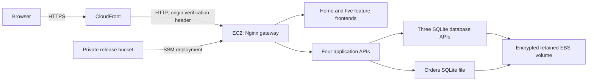

# Release 2 AWS deployment

Current source/configuration describes the existing five features and their CRUD APIs on one EC2 host in `ap-southeast-2`. The local Release 1 Compose layout remains available. Ollama, MCP, RAG and Multi-Agent are disabled in the cloud configuration.



Current status (17 October 2026): shared gates, smoke/provenance and local model
support are implemented on `ethan-goldman`. Actual local cloud-bundle checks pass;
current AWS access, host recovery, OIDC, main integration and final public Actions
deployment remain unverified. The running-state, plan and sizing observations
below are dated historical evidence. See the [current shared handoff](../reports/release2-shared-cloud-and-testing.md)
and [ledger](../evidence/release2-ethan-goldman/progress.md).

## Design choices

- One public HTTPS origin gives all features a shared secure session cookie. Paths are `/catalogue/`, `/inventory/`, `/account/`, `/orders/` and `/support/`.
- `cloud/prepare.py` builds a source-only cloud bundle and rewrites the original browser-local URLs. It excludes existing databases, environment files, Git metadata and local generated files. It refuses to overwrite a build directory.
- Gunicorn serves Flask in the cloud. The gateway is the only published container port. Database APIs and feature APIs communicate through the private Compose network.
- EC2 ingress accepts port 80 only from the AWS-managed CloudFront origin-facing prefix list. A generated secret header rejects requests from other distributions. No SSH port is opened; administration uses Systems Manager.
- The host fetches release files and generated credentials with an instance role. IMDSv2 and a hop limit of one prevent bridge-network application containers from using that role.
- Accounts, products, support and orders databases live under `/srv/asd/data` on encrypted EBS, outside release directories. The generated session key also survives releases. Initial seed passwords come from Secrets Manager; existing database hashes are not replaced.
- The EC2 default is `t3.small`, verified eligible for this project's Free plan. Local idle measurements were approximately 550 MiB across the 14 containers. This is an assessment baseline; load and sustained CPU usage still need measurement.

## Provision and release

Use the AWS Toolkit profile and confirm the selected Region in **AWS Settings → View all projects → Overview → Additional Info → Region**. All Regional resources in this template are in Sydney.

```bash
export AWS_PROFILE=aws-toolkit
bash cloud/provision.sh
python3 cloud/deploy.py --release manual-unique-id --report deployment-report.json
```

Provisioning validates the template and checks the chosen instance type against the project's current plan before changing the stack. It creates the VPC, host, retained storage, private release bucket, secrets and CloudFront distribution. The host installs Docker and a checksum-verified Compose binary.

Deployment requires a clean, committed main checkout, including no untracked source. Actions also verifies its repository/ref/SHA/run attempt; manual main deployments remain labelled manual and cannot establish final Actions release evidence. Deployment creates a source archive, uploads it to S3 and executes installation through SSM. The host verifies the archive hash, builds containers and runs both loopback and public integrated authentication/CRUD/disabled-AI checks. Running flags, container health/services and host listeners must establish the disabled baseline before acceptance. Only a passing release becomes `/srv/asd/current`. A failed update attempts to restore the previous containers; database changes are not rolled back. Do not introduce destructive database migrations without a separate backup and recovery plan.

`deployment-report.json` records the source commit, bundle SHA-256, release ID,
UTC capture, run/attempt, SSM command, instance, public target and acceptance.
`deployment-evidence/deployment-result.json` contains validated remote paths/hashes
for `local-smoke.json`, `public-smoke.json` and `runtime.json`. Native captures stay
in the immutable `/srv/asd/releases/<release>-<digest-prefix>/` directory; retrieve
those three files through SSM, verify their hashes, and add them to the final
review manifest. Remote paths alone cannot satisfy the report collector. No new
public diagnostics route is exposed. Host `deployment.log` stays private; neither
raw SSM stdout/stderr nor the full Docker environment is exported. Failed/pending
SSM commands retain safe failure status/identity when available, and Actions
attempts artifact upload on failure. A rollback attempt is not proof of restored
health; inspect the previous release afterward. No database rollback is performed.

S14's local fixture checks establish the code paths; actual SSM/public/resource
stability and five same-SHA workflow evidence still belong to S16. No successful
live deployment is claimed by these source changes.

SSM command IDs and sanitized deployment reports provide evidence. Do not paste `cloud.env`, Secrets Manager values, cookies or raw `docker inspect` output into reports. The seed password can be retrieved privately from the stack's `DemoPasswordArn` for `admin@asd.local` and `customer@asd.local`; it is not published in source or stack outputs.

## Stop and resume sessions

Historical setup state: the initial environment was stopped after verification at the user's request. Its URL is `https://dww8d9hiqp0ce.cloudfront.net`; it is unavailable while EC2 is stopped. Current EC2/OIDC/availability state must be checked after AWS authentication is restored; the historical stop is not a current-state observation. The instance ID is `i-03a217a6a7f61d3ae`. Start it for the next group session:

```bash
aws ec2 start-instances --profile aws-toolkit --region ap-southeast-2 --instance-ids i-03a217a6a7f61d3ae
aws ec2 wait instance-running --profile aws-toolkit --region ap-southeast-2 --instance-ids i-03a217a6a7f61d3ae
```

Allow Docker and the APIs time to become ready, then check the public homepage and sign-in. The Elastic IP keeps the CloudFront origin address stable. Use Systems Manager to investigate startup rather than opening SSH. Stop it after a session:

```bash
aws ec2 stop-instances --profile aws-toolkit --region ap-southeast-2 --instance-ids i-03a217a6a7f61d3ae
aws ec2 wait instance-stopped --profile aws-toolkit --region ap-southeast-2 --instance-ids i-03a217a6a7f61d3ae
```

Stopping saves compute charges but retains both disks, the Elastic IP and secrets. See [cost estimates](../evidence/release2-aws/cost-estimate.md). Deployment reports describe successful checks made while the host was running; they do not imply the stopped website is currently reachable.

## GitHub deployment

`.github/workflows/cloud-deployment.yml` runs seven isolated test suites (including
shared Multi-Agent) and a cloud container build. A bounded read-only gate also
requires all five [verified named student workflows](../reports/release2-workflow-mapping.md)
to pass for the exact main push SHA and latest run attempts. Every reported job
must pass; a PR run, stale SHA, missing/skipped job or old green attempt is
insufficient. The gate alone receives Actions read permission and uploads its
sanitized report even on failure. The source deployment remains main-only.

The deployment job rechecks main before requesting AWS credentials. The CLI
checks it before upload and immediately before SSM, and the locked host checks
again before replacement and acceptance. Superseded candidates are skipped by
the workflow/CLI; a host-side change fails acceptance and attempts previous-code
restoration. The host reads this public repository reference without receiving
the GitHub token; an unavailable API fails acceptance. This handles stale queued candidates without deploying artifacts
from an untrusted workflow_run. A stable current main and real five-student
Actions/SSM evidence remain required in S16. Configure a GitHub environment named `aws-cloud`, with `AWS_DEPLOY_ROLE_ARN` and optionally `AWS_STACK_NAME` environment variables. The AWS role trusts only this repository and that environment using OIDC; no long-lived access keys are needed.

The template's `EnableGitHubOidc` parameter defaults to `false`. This project's managed policies explicitly denied IAM OIDC provider creation, read and list operations during setup. The actual GitHub role and a successful GitHub deployment run remain to be established; preparing a workflow does not verify CI/CD. If the project permits OIDC, enable the template option with `ENABLE_GITHUB_OIDC=true`; supply `GITHUB_OIDC_PROVIDER_ARN` when reusing an existing provider. Project capability changes belong in AWS Settings and require the project owner's decision. AWS documents these restrictions in its [project capability guide](https://docs.aws.amazon.com/accounts/latest/reference/supported-services-sign-up-new.html).

## Validation and limitations

Historical initial-port evidence: 677 Python tests passed with ten optional live-service tests skipped, plus 44 integrated local cloud checks. A request without the gateway's origin verification header was rejected with HTTP 403. The template passed cfn-lint, the repository's targeted cfn-guard rules and AWS `validate-template`. These checks cover this change; they do not establish that all Release 2 assessment requirements are complete.

This baseline has a single host and SQLite databases. It has no automatic failover, scheduled database backups or centralized application-log collection. Container logs rotate on disk; CloudTrail event history is available but no durable trail was configured. CloudFront provides browser HTTPS, while the restricted origin connection currently uses HTTP. An ALB with origin TLS and managed database/backup services are possible next steps if the group decides it needs stronger availability or end-to-end transport encryption.

Retained EBS, the release bucket and seed-password secret survive stack deletion. Deleting a stack does not fully remove storage charges. Before cleanup, identify these resources and decide whether application data must be preserved or exported. The failed initial stack contained no deployed application data; its unused retained resources were removed with explicit user approval before the eligible-instance retry.

## Group decisions still needed

Decide who owns the AWS project and invites team members; whether to keep this shared environment running; the acceptable credit budget; how demo credentials are shared privately; who can approve deployments; whether the current availability, logging and backup limits are sufficient; and how OIDC capability will be enabled. The support Multi-Agent implementation, explicit support endpoint CI and review modes are implemented. Genuine human review, remaining member evidence, final integrated deployment and report/showcase acceptance remain required.

Cloud matrix/build validation also runs on relevant PRs. Gate and deployment
remain main-only; concurrency is separated by ref so PR validation cannot replace
a pending main deployment. No PR artifact is deployed.

The cloud workflow also runs on every main push, including documentation-only
commits. Otherwise a new main SHA could supersede a queued candidate while path
filters prevent its replacement workflow from starting. PR validation retains
its source-path filters; actual deployment still requires all main-only gates.
