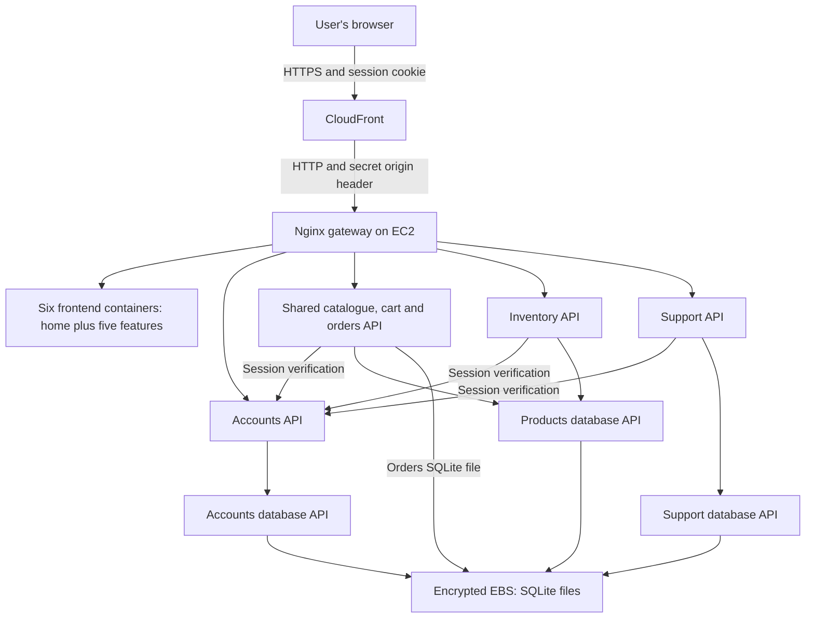

# AWS cloud port: explanation and group handover

Prepared 12 October 2026 from the implementation and the 9 October deployment evidence. This guide is for explaining the work in the showcase and for handing operation of the shared environment to the group.

## 1. What we actually built

We adapted the existing Release 1 marketplace to run on one AWS EC2 Linux virtual machine. Docker Compose runs the existing frontends, Flask APIs and SQLite database services. CloudFront supplies a public HTTPS entry point. Application records live on encrypted EBS storage outside the release folders. Reusable scripts provision infrastructure and deploy source releases through AWS Systems Manager.

This is the Release 2 cloud baseline. The new Planner → Worker → Reviewer → Human implementation, its frontend integration, student testing assignments and the complete report/showcase remain separate work. Ollama, MCP and RAG servers are not started in this cloud deployment. Their clients remain in the source, with the cloud flags disabled.

The live environment is identified by:

| Item | Value |
| --- | --- |
| Repository | `https://github.com/egoldman2/ASD` |
| CloudFormation stack | `asd-release2` |
| Selected Region | `ap-southeast-2` — Sydney |
| Public URL | `https://dww8d9hiqp0ce.cloudfront.net` |
| EC2 instance | `i-03a217a6a7f61d3ae` |
| Default development CLI profile name | `aws-toolkit` |

On 12 October, read-only AWS checks found the host running and the project on its active Free plan, reporting US$97.49 in remaining credits. The earlier stopped-state JSON is historical evidence from 9 October, not a live monitor.

## 2. The architecture and why each service exists



There are 14 containers: six frontends, four application APIs, three database APIs and one gateway. Catalogue/cart and orders share the root Flask application, so the system does not have five separate application API containers. Inventory and catalogue use the same product database service.

| Component | Its job in this implementation |
| --- | --- |
| EC2 | Supplies the Linux host, CPU and memory for Docker. The chosen type is `t3.small`, with 2 GiB RAM. |
| Docker Compose | Builds images, creates the internal container network, starts services, applies environment settings, mounts data and checks readiness. |
| Nginx gateway | Receives web traffic and sends each path to the correct frontend or API. |
| CloudFront | Supplies a public hostname and browser HTTPS. Authenticated responses have caching disabled. |
| Elastic IP | Keeps the origin's public address stable across EC2 stop/start. |
| VPC, subnet, route and security group | Connect the host to the internet while restricting inbound traffic to CloudFront origin addresses on port 80. |
| EBS | Stores the operating system on a 20 GB disk and deployment/data files on a separate retained, encrypted 30 GB disk. |
| S3 | Holds private source archives used for releases. It does not serve the marketplace frontend and is not the application database. |
| Secrets Manager | Holds the origin verification token and generated initial demo password. |
| Systems Manager (SSM) | Runs deployment commands on the host without opening SSH. |
| CloudFormation | Creates and tracks the related infrastructure as one stack from a YAML template. |
| IAM instance role | Lets the host read this deployment's release archives and secrets and communicate with SSM without embedded AWS keys. |

This deployment does not use ECS, EKS, Fargate, Lambda, ECR, RDS or DynamoDB. Docker images are built on EC2 from the uploaded source. SQLite remains the database technology. Regional resources are in Sydney; CloudFront is a global service.

## 3. What changed when porting local code

The local app used different `localhost` ports for its features and APIs. In a remote visitor's browser, `localhost` means that visitor's own computer. Those addresses therefore cannot be shipped unchanged to a public site.

`cloud/prepare.py` makes a fresh cloud copy of the allowed source files. It rewrites the known browser URLs to paths under one public origin, changes navigation to recognise feature paths, adds HTML base paths for relative assets, and rejects remaining browser-local URLs. It keeps the original local source layout available for development. The generated copy excludes existing database files, environment files and Git history: we deployed fresh seeded cloud data, not the contents of everybody's local databases.

| Local frontend | Cloud path |
| --- | --- |
| Home, port 8000 | `/` and shared `/assets/` |
| Chufeng, port 8001 | `/catalogue/` |
| Ryan, port 8002 | `/inventory/` |
| Ethan Ting, port 8003 | `/account/` |
| Howard, port 8004 | `/orders/` |
| Ethan Goldman, port 8005 | `/support/` |

| Public API path | Internal destination |
| --- | --- |
| `/account-api/api/...` | Accounts API at `ethan-backend:6002` |
| `/inventory-api/api/...` | Inventory API at `inventory-backend:8102` |
| `/api/support/...` | Support API at `customer-support-backend:6005` |
| Other `/api/...` | Shared API at `shared-backend:5000` |

Nginx strips the account/inventory routing prefixes before forwarding requests. Internal names such as `ethan-backend` are Docker service names, resolved inside the container network; a user's browser does not call those names. Database APIs have no public published ports.

Other compatibility changes were:

- A shared `PUBLIC_ORIGIN` validator gives APIs their cloud origin allowlist while preserving the local defaults.
- Cloud login redirects and return URLs use the public feature paths and restrict destinations to trusted same-origin pages.
- Cloud session cookies use `Secure`, `HttpOnly` and `SameSite=Lax`.
- The initial cloud passwords are generated instead of using the published local demo passwords. Passwords remain hashed in the accounts database.
- Howard's orders database path is configurable, so it can live on persistent storage rather than in the application source directory. Existing data is not reseeded.
- Support redirects use configurable public paths.
- Flask is served by Gunicorn in the cloud, using one worker with four threads for each application/database API.
- Inventory now returns HTTP 403 for a valid customer attempting administrator-only operations. Previously it incorrectly described that case as an authentication-service error, HTTP 503.
- Build and Git ignore rules exclude generated cloud directories, credentials and database files.

## 4. Follow a real request

For product browsing, the browser requests the CloudFront URL `/catalogue/`. CloudFront forwards the request to the EC2 gateway. Nginx serves the catalogue frontend through its frontend container. Its JavaScript requests `/api/products`; the gateway sends that to the shared Flask API, which requests product records from the product database API. That service reads SQLite and returns data through the same chain to the browser.

For login, the browser posts to `/account-api/api/login`. The gateway forwards that to the Accounts API. It retrieves the relevant stored password hash through its database API and verifies the password. On success, it returns the existing Flask signed session cookie. This is a cookie-based Flask session, not Cognito, a JWT migration or a new cloud identity system.

For a protected request, such as changing inventory, the browser sends the cookie and its public `Origin`. The Inventory API checks the trusted origin for mutations, verifies the session through the Accounts API and checks administrator access before changing product records through the product database API. The backend enforces permissions; hiding an admin navigation link is only a frontend convenience. HTTP 401 means sign-in is required, 403 means access is forbidden, and 503 means a dependency is unavailable or an assistant is deliberately disabled.

Using one HTTPS origin means the browser can use the same cookie across all feature paths. Nginx passes cookies onward, and CloudFront forwards them while avoiding caching private responses.

## 5. Provisioning versus deploying a release

Provisioning creates AWS resources. Deploying a release changes the application running on those resources. A normal feature change needs a release deployment, not a new VPC or instance.

`cloud/provision.sh` validates the template, checks the selected instance type against the project's plan, discovers the CloudFront prefix list and creates or updates `asd-release2`. The template creates networking, encrypted storage, the EC2 host, S3, secrets, roles and CloudFront. At first boot, EC2 user data installs Docker, finds and mounts the attached data disk, downloads a checksum-verified Compose binary and writes a bootstrap-ready marker. It formats only a disk with no recognised filesystem.

The first attempt used `t3.medium` and AWS rejected it under this project's Free-plan eligibility policy. With explicit approval, the failed stack and its unused retained volume, empty bucket and seed secret were removed. The successful retry used eligible `t3.small`; the script now checks eligibility before changing a stack.

```mermaid
flowchart LR
    Source[Developer's checked-out source] --> Prepare[Prepare cloud copy]
    Prepare --> Archive[Archive plus SHA-256]
    Archive --> Bucket[Private S3 release object]
    Bucket --> SSM[SSM command on EC2]
    SSM --> Install[Verify hash, extract, fetch secrets]
    Install --> Compose[Build and start containers]
    Compose --> Checks[Health checks and integrated smoke tests]
    Checks --> Current[Accept release and update current pointer]
```



`cloud/deploy.py` reads stack outputs instead of requiring each developer to know bucket and secret identifiers. It bundles the current source, uploads it and sends an SSM command. The host downloads the archive using its own role, verifies its checksum and invokes `cloud/install.sh`.

The installer uses a host deployment lock, writes a private `cloud.env`, reuses the persistent session key, builds and starts containers, then runs `cloud/smoke.py` against both loopback and the public HTTPS origin and inspects actual runtime flags/listeners. Successful releases update `/srv/asd/current`. If startup or smoke checks fail, the installer attempts to restore the previous containers. Release-specific image tags avoid overwriting the previous application images.

The SHA-256 verifies the archive downloaded by the host matches the uploaded release. It does not prove that the code was reviewed. Deployment now rejects dirty/untracked working copies and non-main source. Actions additionally checks the checked-out SHA/ref/repository and release attempt. A manual main deployment is labelled manual and does not establish final Actions release evidence. See [the current evidence/runbook](aws-deployment.md) for safe failure artifacts and native capture retrieval.

## 6. Data persistence, security and their limits

Application databases are under `/srv/asd/data/accounts`, `/products`, `/support` and `/orders` on the retained data volume. Containers see their assigned directory as `/data`. These are bind mounts: records are written to the disk rather than a container's disposable writable layer. Deployments replace source and containers while reusing those directories.

EC2 stop/start preserves EBS. Container replacement also preserves the bind-mounted data. The data volume, release bucket and initial password secret have retain policies when the stack is deleted. Retention means those resources can survive deletion and keep costing money; it does not automatically reconstruct their connections to a new stack.

Persistence is not a backup. We have not configured scheduled backups or proved restore after disaster. Rollback restores application containers, not database transactions or schema migrations. The accepted second release verified reuse of the existing databases, not host-replacement or disaster recovery.

The security group accepts only CloudFront origin-facing addresses on port 80, and the gateway also checks a generated secret origin header. This prevents relying on the prefix list alone, which is shared by other CloudFront distributions. SSH and API/database ports are not opened publicly. The host uses IMDSv2 and a hop limit of one to keep its metadata credentials out of the normal Docker bridge containers. These controls are not a claim of protection against a compromised host or privileged container.

Browser → CloudFront uses HTTPS. CloudFront → the restricted EC2 origin currently uses HTTP. Do not describe the whole path as end-to-end TLS. The S3 bucket blocks public access and requires secure transport; both EBS disks are encrypted.

The two Secrets Manager secrets are the gateway token and the initial seed password. The Flask session-signing key is generated on the retained volume. Secret values are fetched at deployment, kept out of source and reports, and written into a restricted host environment file. People with project administrator or host access can still access secrets. Changing the seed secret alone does not rotate existing database password hashes.

This remains a single-host, single-AZ environment with SQLite: no automatic failover, no autoscaling, brief deployment downtime, and unverified load/stop-start recovery. Logs rotate on the host; no centralized app-log collection or durable CloudTrail trail was configured. Basic CloudTrail event history is available.

## 7. What was tested and what we can claim

The 9 October evidence records 677 passing Python tests and 10 optional live-service tests skipped. New checks cover source-bundle boundaries, origin validation, generated seed passwords, data not being reseeded and the inventory customer/admin distinction. Existing feature and shared MCP/RAG suites were also exercised.

The template passed cfn-lint, the repository's targeted cfn-guard rules and AWS template validation. These do not prove every security or runtime property.

Local integrated cloud checks and public CloudFront checks each passed 44 HTTP checks: frontends and shared assets, sign-in, cookie attributes, protected endpoints, role restrictions, cross-feature product visibility, account/product/cart/order/ticket CRUD and disabled assistant responses. Temporary test records are removed; the application soft-deactivates temporary accounts. Chrome also verified navigation and the cart-to-sign-in redirect.

See `docs/evidence/release2-aws/` for reports. Do not claim a successful GitHub cloud workflow, load test, disaster restore, stop/start recovery test or completed multi-agent feature. Those have not been verified.

## 8. Give group members independent access

On 12 October, AWS confirmed that invitations were sent to all four teammates for the existing `Console Dot Dream` project. They were pending acceptance at verification. The cloud port and this guide were pushed directly to the shared repository's `main` branch. Teammates can pull the code now and operate AWS after accepting their own invitation and signing in.

There are three different kinds of access. An application administrator login operates marketplace data. GitHub repository access lets a teammate edit code and open PRs. AWS project access lets them operate infrastructure. One does not automatically provide the other two.

In this project's new AWS experience, the project owner invites members through **AWS Settings → Team → Invite new team member**, chooses the existing project and sends invitations. AWS says members get broad resource administrator access, including resource creation and deletion, while owner-level billing, plan changes and team management remain restricted. Each teammate accepts using their own AWS Builder ID. Use each person's own identity and local temporary credentials; do not distribute the owner's `.aws` directory, tokens or access keys. [AWS invitation documentation](https://docs.aws.amazon.com/accounts/latest/reference/invite-team-members.html)

The repository history identifies these GitHub users: Chufeng `chufengli-1-spec`, Ryan `ryanol945`, Howard `HowardOng7` and Ethan Ting `frosty091o`. Commit identities establish contributions, not current collaborator permissions or a preferred AWS sign-in email. A GitHub no-reply email is not suitable for an AWS invitation. Private invitation details should stay out of this public repository.

For CLI work, use AWS CLI v2.32 or newer, Python 3.11 or newer, a checked-out repository and an authenticated profile for this project. The AWS Toolkit or browser-based AWS CLI sign-in can obtain temporary credentials; credentials and profile configuration are specific to each teammate's computer. This setup is required once per person, with sign-in renewed as sessions expire. [AWS temporary CLI sign-in documentation](https://docs.aws.amazon.com/cli/latest/userguide/cli-configure-sign-in.html)

Before operating, verify the selected Region in **AWS Settings → View all projects → Overview → Additional Info → Region**, and verify the identity/project:

```bash
aws sts get-caller-identity --profile aws-toolkit --region ap-southeast-2
```

The returned project number should be `059643396979`. The local profile name can be different, but the project and Region must match. After invitations are accepted and the cloud files are shared in GitHub, team members can perform these actions from their own machines:

```bash
# Inspect the host without changing it.
aws ec2 describe-instances --profile aws-toolkit --region ap-southeast-2 \
  --instance-ids i-03a217a6a7f61d3ae \
  --query 'Reservations[0].Instances[0].State.Name' --output text

# Start for a group session; allow the containers time to become ready.
aws ec2 start-instances --profile aws-toolkit --region ap-southeast-2 \
  --instance-ids i-03a217a6a7f61d3ae
aws ec2 wait instance-running --profile aws-toolkit --region ap-southeast-2 \
  --instance-ids i-03a217a6a7f61d3ae

# Deploy only a clean, committed main checkout after normal PR integration, while EC2 is ready.
AWS_PROFILE=aws-toolkit python3 cloud/deploy.py \
  --release teammate-reviewed-release-id --report deployment-report.json

# Stop after the group has finished using the shared site.
aws ec2 stop-instances --profile aws-toolkit --region ap-southeast-2 \
  --instance-ids i-03a217a6a7f61d3ae
```

The deployment script has no third-party Python dependency and invokes AWS CLI. Docker is needed on a developer's machine for local development/container validation, but the manual cloud deployment command builds its images on EC2. Follow the existing feature test instructions before deploying. Demo login credentials can be privately retrieved by authorised members from the stack's `DemoPasswordArn` in Secrets Manager; never publish the value in this guide.

Use SSM to inspect host operations. For example, a developer with the required access can request `docker ps` through the AWS Run Command document, then inspect the returned command ID. The instance must be running and online in Systems Manager. Avoid raw environment inspection in logs or evidence because it can expose secrets.

Independent access does not mean five isolated deployments. Every manual deployment replaces the shared group's whole application, and stopping the host affects everyone. Agree on deployment windows and an identified reviewed commit. The installer prevents simultaneous installations, but a later teammate's accepted release can still replace an earlier one. Separate preview stacks would need additional infrastructure, data setup and budget; they are not currently provisioned.

## 9. GitHub deployment and its current blocker

`cloud-deployment.yml` now defines seven isolated test suites, a cloud image-build
job and a bounded five-student workflow gate. Deployment requires all three and
an exact main candidate. The gate checks the versioned existing workflow IDs/paths,
main push SHA and latest-attempt jobs; all must succeed. Every named student
workflow triggers on every main push, with all AI flags/live opt-ins disabled.
Only the gate receives Actions read access. The deployment job uses `aws-cloud`,
an OIDC token and `cloud/deploy.py`, after a fresh main-reference check. CLI and
locked-host checks prevent a queued stale candidate from replacing the intended
main release. Sanitized gate/deployment reports upload even on failure. These
source changes are locally verified; actual integrated Actions/SSM acceptance
remains outstanding. Configure environment branch rules and any desired review requirements explicitly; they are not created by the YAML.

OIDC lets GitHub obtain short-lived AWS permissions using a role trusted for `repo:egoldman2/ASD:environment:aws-cloud`. The proposed role can write release objects and send commands to this host. SSM command access is powerful host access, so treat deployment permission accordingly. It does not grant a teammate billing ownership.

The managed project policy denied OIDC provider creation, read and listing on 9 October. The role is optional in the template and disabled by default; GitHub automatic deployment is therefore prepared but not operating. Do not try to solve an explicit project-policy deny by sharing owner keys or merely adding another Allow policy. The owner must resolve supported project capabilities in AWS Settings, then the group can create the provider/role, set `AWS_DEPLOY_ROLE_ARN` in `aws-cloud` and verify a real workflow run. We have not changed the project plan or enabled advanced capabilities. [AWS managed project policies](https://docs.aws.amazon.com/accounts/latest/reference/scps-and-rcps-for-projects.html)

The first real cloud workflow run after publication passed the image build and four validation jobs, but the two feature paths containing spaces were split by the shell before pytest ran. The workflow was corrected to pass each suite as a JSON array of exact paths. This illustrates why a local test result and a successful GitHub invocation are separate evidence. A workflow also cannot deploy until its AWS role is configured, even when tests and builds pass.

The [corrected 12 October run](https://github.com/egoldman2/ASD/actions/runs/38200811684) passed all six validation jobs and the cloud image build. It then failed the deployment role configuration check. Use it as validation/build evidence and evidence of the remaining deployment blocker, not as a successful automatic AWS deployment.

The current alternative is manual deployment by any invited and authenticated teammate. The host must be started and ready first; this workflow currently does not automatically start a stopped instance.

## 10. Short answers for the showcase

**What does “ported to AWS” mean here?** We adapted the existing containerised app to a remote Linux host, public HTTPS routing, cloud configuration, persistent encrypted data and repeatable deployment. We did not rewrite its business features or change its database technology.

**Why couldn't you just upload the repository?** Browser `localhost` links would call the visitor's own computer, sessions needed one public origin and secure cookies, databases needed a persistent location, published seed passwords needed replacement, and the cloud host needed a repeatable startup/deployment process.

**Why EC2 with Compose?** It preserves the working Release 1 container layout with a relatively small migration. The trade-off is responsibility for host operation and a single point of failure. Managed containers/databases would require further design and migration.

**What happens when you redeploy?** Source is packaged, uploaded, verified and rebuilt on the host. Containers use the same external data directories. Smoke checks run before accepting the release, with a previous-container recovery attempt on failure.

**Is the database in S3?** No. S3 holds source archives. The live databases are SQLite files on EBS, mostly accessed through the original database API containers.

**Why is CloudFront there if you're not caching?** It supplies the HTTPS hostname and public gateway to the restricted EC2 origin. Private/API responses are configured not to be cached.

**Is everything encrypted?** Browser access is HTTPS, EBS and S3 data are encrypted at rest, and S3 access requires HTTPS. The CloudFront-to-EC2 hop currently uses restricted HTTP. End-to-end TLS remains an improvement.

**Where is AI?** AI remains in the local workflow. Cloud flags disable model, MCP, RAG and future multi-agent use, and no corresponding AI servers are started in this baseline.

**Can the group work without Ethan's laptop?** The AWS host runs independently. Once invited to the AWS project and given the shared repository changes, teammates can authenticate, start/stop it, deploy and diagnose it themselves. Project ownership/billing decisions and the unresolved GitHub OIDC capability still require owner involvement.

**What are the main limitations?** Single host/AZ, SQLite, update downtime, no scheduled backup or proven disaster restore, limited centralized monitoring, unverified load and stop/start recovery, and unverified GitHub cloud deployment.

The cost comparison in `docs/evidence/release2-aws/cost-estimate.md` was checked on 9 October: about US$28.52/month running continuously or US$9.25/month fully stopped, before credits, tax and variable usage. Actual credits and usage change over time; the owner checks spend in AWS Settings → Billing.
