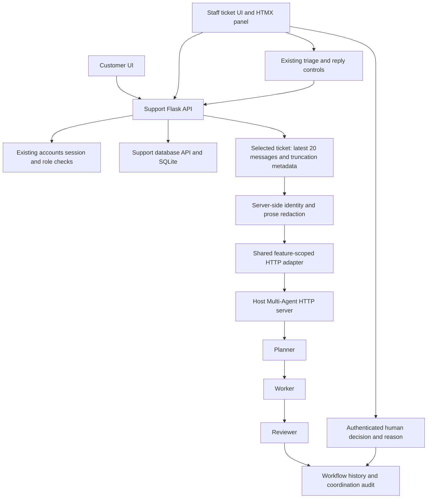

# Release 2 — Ethan Goldman contribution (S18a working draft)

Updated 18 October 2026, Australia/Sydney (AEDT). **Release incomplete.** This
is material for the group editor, not the final PDF, attendance declaration or
human release decision. Implementation and operations used automated coding assistance
on `ethan-goldman`; all checkpoint commits, checks and limitations are in the
[progress ledger](../evidence/release2-ethan-goldman/progress.md). Canvas confirms
[Group 33](https://canvas.uts.edu.au/groups/399683). The [Release 2 assignment](https://canvas.uts.edu.au/courses/39716/assignments/267943)
displays 25 October, 23:59 with the profile timezone Sydney; its brief says AEST.
The timezone wording and official numeric workflow allocation need confirmation.

## Scope and support design

Ethan's responsibilities are Customer Support, shared AWS deployment, Testing
Report Review and Cloud Deployment Report Review. Other members retain their
feature implementations and reports. The support workflow reviews one selected
ticket and proposes a reply/action; existing triage/reply controls perform actual
business changes. Human approval stores a decision and reason only.

Authentication, staff role and trusted-origin checks precede mutation. The backend
selects the ticket and constructs provenance; the browser cannot choose feature,
reviewer identity, source URLs or evidence. Reads verify both support scope and
ticket identity. Replies/messages and proposed actions remain escaped text. Both
AI and Multi-Agent flags must be enabled. Four cloud AI flags remain false.

The panel shows Planner, Worker, Reviewer, evidence/truncation, history and the
three decisions. A 300-second client budget, 375-second nginx route budget and
380-second UI request budget cover the synchronous service. Invalid responses,
timeouts, disabled services and duplicate decisions fail safely. No queue or
second workflow writer was introduced.

## Implementation and verification

| Work | Checkpoint/source | Evidence |
| --- | --- | --- |
| Baseline and cookie compatibility | S00/S01 `f3c1675` → `c9a05ba` | Five baseline failures repaired without weakening access assertions; 95 historical Ruff findings disclosed |
| Scoped transport and support API | S05–S07 `2d6b5a3` → `a0d40ca` | Catalogue compatibility, selected evidence, derived reviewer, decision persistence and duplicate 409 |
| HTMX panel and explicit endpoint CI | S08/S09 `1ff2c50`, `50fe5ad` | UI/proxy checks, two named endpoint JUnit cases and Docker regression |
| Review modes | S11–S13 `f9dc0c9` → `0b56ed2` | Selected-workflow/history/audit validation; bounded hash-checked testing/cloud manifests and deterministic guards |
| Smoke/provenance and Linux dependency repair | S14 `365b335`, `d42a22a` | Actual generated Linux gateway: 64 checks; fault/rollback/provenance tests; installed dependency audit repaired |
| Same-SHA deployment gates | S10 `9c70b04` → `d8724d2` | Five verified workflow identities, latest-attempt jobs, current-main checks and seven-suite PR validation |
| Actual local demonstration | S15a application `37e859a` | Native model/browser/API captures, two workflows, restart/recreation persistence and loopback-only ports |

Actual model and nginx checks have separate captures; normal CI uses test doubles.
The ledger retains historical checks; current integrated-main results follow.

## Pre-commit and post-commit testing report

The fresh Python 3.11.16 environment uses Flask 3.1.3, Werkzeug 3.1.9, Ruff 0.17.0,
detect-secrets 1.5.0, pip-audit 2.10.1 and pre-commit 4.7.0. Hooks run during every
commit; scoped success does not clear an all-files scan. The latest all-files
Ruff scan reports 44 findings after S00d; [current scan and review](../evidence/release2-ethan-goldman/security/README.md)
retain locations. S00c classifies 18 reviewed SQL false positives with unchanged
production ASTs and two real SQLite safety regressions. The four existing
ChromaDB advisory exceptions remain disclosed. The Linux
cloud image separately exposed vulnerable bundled pip/setuptools; upgrading
those tools produced a zero-vulnerability installed-package audit. That result
does not clear local RAG's ChromaDB exceptions.

Evidence is excluded by the normal secret hook. S15a's separate all-files scan
reviewed 98 known provenance/content/model/row digests, with zero unclassified
findings or new ignores. Exact artifact hashes and private cookie/key substring
checks passed. Native model/AX/console bytes, including whitespace, are preserved.

Goldman's workflow is `.github/workflows/EthanGoldman.yml`. Its named tests are
`test_customer_create_contract` for `customer_create` (`POST /api/support/customer/tickets`)
and `test_admin_update_contract` for `admin_update`
(`PUT /api/support/admin/tickets/<int:ticket_id>`). They check persisted data,
session-derived identity, limits, authorization/origin denials and no mutation on
invalid updates.

After Ethan authorized PR #16, main source `cc6f1e4bdfe81e85da5dc384317510ae36e50935`
passed all five student workflows. Its [native endpoint JUnit](../evidence/release2-ethan-goldman/ci/main-cc6f1e4/endpoint-functions.xml)
has the two required cases with zero failures/skips; [context](../evidence/release2-ethan-goldman/ci/main-cc6f1e4/test-context.json)
records Python 3.11.17, the exact main SHA and all AI/live opt-ins disabled.
The [successful Support run](https://github.com/egoldman2/ASD/actions/runs/39116067484)
also records 206 Support passes/10 skips, 302 shared/cloud passes, 138 MCP/RAG
passes/2 skips and 82 Multi-Agent passes. [Verified artifact provenance and gate](../evidence/release2-ethan-goldman/ci/main-cc6f1e4/verification.json).

## Actual local deployment and workflow report

The isolated root Compose project has 13 application services; Ollama, MCP, RAG
and Multi-Agent remain host processes. All 11 published demo bindings are
loopback-only. Application source `37e859a36492aeaf20994556750d4a5acb66a05a` is
unchanged by the later pipeline-only repair. See [native captures and safe
commands](../evidence/release2-ethan-goldman/local/README.md) and its hash manifest.
Customer navigation/login/create/read and staff triage/reply were exercised on
synthetic ticket #2013. A separate disposable API ticket was deleted and verified
404; the browser permanent-delete button was not exercised.

Actual advisory analysis used Qwen 0.5B. MCP's initial broad answer was Partial;
a narrower queue-summary question succeeded. RAG produced the correct ticket
length limits with an approved citation and separately demonstrated no-context,
no-generation abstention. Read-only calls left the exact ticket unchanged.

UI workflow `3a970ca5-0b90-4e7f-ab84-cd7beb089c28` and terminal HTTP workflow
`67702aa8-4a5f-4cd0-a311-8bd952ed18d5` each completed real Planner/Worker Qwen 3B
and Reviewer Llama 3.1 8B. Native history/audit and both generated outputs survive
restart and scoped container recreation; old sessions and ticket data also
persist. Both proposals repeat an already-requested information request. On
18 October Ethan explicitly accepted both with the reason `nothing needed.`;
the existing Chrome staff controls recorded each decision as `user:1`. The
[completed review evidence](../evidence/release2-ethan-goldman/local/human-review-20261018/README.md)
verifies the exact saved decisions, matching audit/history and unchanged ticket,
messages and model outputs, including after another server restart. The actual
selected Support Agentic Loop now verifies complete human/runtime evidence.
Model citation/agent-name grounding still failed, so its report preserves those
issues and uses the existing deterministic fallback. Support regressions pass
206 tests with 10 opt-in skips. This local result is separate from S17 group
review and release approval; the preliminary capture remains historical.

## Cloud report, contribution and remaining handover

The generated cloud bundle has 14 containers including its gateway. Local Linux
fixture CRUD/auth/disabled-AI checks and persistence pass, but this is not public
AWS evidence. The [shared contribution](release2-shared-cloud-and-testing.md)
describes the pipeline, architecture, incident dependencies and final acceptance
inputs. S02a renewed access through Chrome, confirmed Sydney/FREE plan, preserved
both encrypted volumes with private snapshots, started the existing host and
verified SSM/EC2/EBS health. Four consistent SQLite copies pass integrity/FK
checks; the session secret was preserved privately. Public HEAD paths return
200 and 14 containers run with all application AI flags false. [Native recovery](../evidence/release2-aws/recovery-20261017/README.md).
The accepted old manual release has no full source metadata; no new source
deployment or final acceptance is claimed. Historical global OOM cause remains
unresolved; fresh OIDC listing is explicitly SCP-denied. No paid/capability
change or model hosting occurred.

Source changes are integrated through the authorized [PR #16 merge](https://github.com/egoldman2/ASD/pull/16)
into main at `cc6f1e4`. All seven cloud suites, image build and the exact-main
five-workflow gate pass. The [actual deployment attempt](https://github.com/egoldman2/ASD/actions/runs/39116067546)
fails at `Require configured deployment role`: `AWS_DEPLOY_ROLE_ARN` is empty.
AWS credential configuration and publish/SSM steps were skipped. Renewed SDK
access confirms FREE/active, healthy EC2/SSM and the explicit OIDC SCP denial.
Ethan retained the current plan; no Paid/Advanced change is authorized.
Dates/SHAs in the ledger describe actual work;
no meeting attendance, teammate participation or video presentation is invented.
Owner evidence, S03 stability/OIDC access,
actual Actions deployment, three final reviews, release-owner decision, group
PDF/video and marking-window retention remain required. Bonus points are unclaimed.

S03a measures substantial recurring Python health-probe CPU overhead on the old
manual runtime. The source now spaces steady probes to 30 seconds, retains
five-second startup checks and the 150-second configured failure interval
budget. [Native measurements and verification](../evidence/release2-aws/cpu-probes-20261017/README.md).
This source repair is not deployed; S03 still requires main-only deployment and
representative-load stability. Historical OOM root cause remains incomplete.
