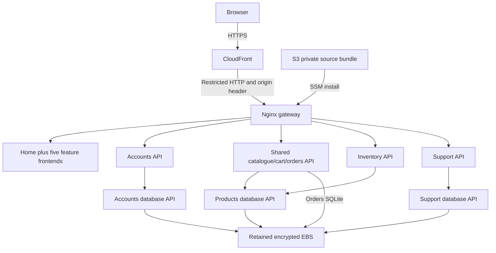
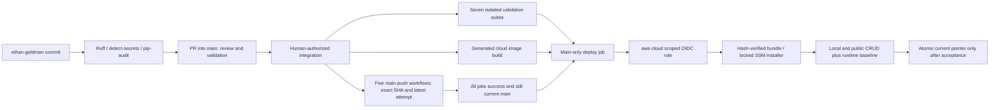

# Release 2 — shared cloud and testing contribution (S18a draft)

Updated 18 October 2026 (Australia/Sydney). **Release incomplete; no human release
approval.** This is Ethan Goldman's group-editor handoff. The final PDF has a
3,000-word cap across all contributors; these repository reports are source
material, not a claim that appendices or tables are exempt. Canvas confirms
[Group 33](https://canvas.uts.edu.au/groups/399683), so the final filename is
`group-33.pdf`. The [assignment](https://canvas.uts.edu.au/courses/39716/assignments/267943)
displays 25 October, 23:59 with the profile timezone Sydney; its brief says AEST.
The timezone wording and official numeric workflow allocation need confirmation.

## Implemented architecture and boundaries

The generated cloud application has 14 containers: six frontends, four application
APIs, three database APIs and a gateway. Catalogue/cart and orders share the root
Flask API. The root local demonstration has 13 containers without the additional
cloud gateway. Ollama/MCP/RAG/Multi-Agent run separately on local host loopback;
all four integrations are disabled in the required cloud baseline.

The template provisions Regional resources in `ap-southeast-2`; CloudFront is
global. One HTTPS origin supports secure shared sessions and avoids browser-local
URLs. The private Compose network hides database/API ports. EC2 accepts origin
HTTP only from the CloudFront prefix list and verifies a generated header; this
is not end-to-end TLS. Retained EBS holds SQLite and persistent generated session
configuration outside immutable source releases. S3 stores source, not live data.
SSM replaces SSH; instance permissions and IMDSv2 constrain host access.
S02a verified both encrypted volumes, private completed snapshots, the expected
data mount and all four false AI flags on the four running application APIs.
These checks describe the old manual release; final deployment protection and
acceptance must still be verified at its main SHA.

## Source, hooks, CI and deployment

All authoring remains on `ethan-goldman`; integration uses PRs. Main pushes trigger
all five [verified named workflows](release2-workflow-mapping.md) and cloud CI,
including docs-only pushes so a newer main SHA always has a replacement candidate.
PR checks cannot deploy. Per-ref concurrency keeps a PR from replacing a pending
main release. The gate rejects missing, failed, skipped, stale or wrong-workflow
jobs and rereads latest attempts. Only the gate has Actions read; deployment has
Contents read plus scoped OIDC. Current-main checks run before credentials,
before upload/SSM and on the locked host before replacement and acceptance.
API failure fails closed. No long-lived AWS keys or workflow_run artifact deploys
were introduced.

The CLI requires clean committed main, verifies Actions identity and records
source SHA, bundle digest, release ID, run/attempt, SSM command and accepted path.
The installer checks actual public/loopback CRUD, disabled responses, flags,
services, health and absence of model listeners before accepting the release.
Failed updates attempt previous-code restoration; SQLite changes are not rolled
back. A rollback attempt never establishes restored health. Safe artifacts upload
on failure without cookies, secrets, raw SSM output or full container environments.
Native host captures must be retrieved through SSM and hash-checked; remote file
references alone cannot satisfy final review.

Reusable scripts are `cloud/provision.sh`, `prepare.py`, `check_workflows.py`,
`deploy.py`, `install.sh`, `smoke.py` and `provenance.py`. The current
[runbook](../architecture/aws-deployment.md) explains invocation and native file
retrieval. Manual deployment remains labelled manual and cannot satisfy the
required final Actions deployment. S04a verified the repository's actual immutable OIDC prefix, corrected the
name-only template default and configured a real main-only aws-cloud branch rule.
Local template lint and four targeted Guard checks pass. S04a's role-variable
lookup returned 404. S02a's renewed access validated the template through AWS,
but OIDC-provider listing failed with an explicit managed SCP deny;
[S02a evidence](../evidence/release2-aws/recovery-20261017/README.md).
No verified deploy role or successful role assumption exists.
PR #16 was subsequently merged with Ethan's explicit authorization; Paid/Advanced
changes remain unauthorized.

## Actual test/security outcomes

At the authorized PR #16 merge SHA `cc6f1e4`, all five student workflows,
seven cloud validation suites, cloud image build and
the exact-main gate pass. [Native gate, endpoint/context files and archive verification](../evidence/release2-ethan-goldman/ci/main-cc6f1e4/verification.json)
retain actual results. [Main cloud run](https://github.com/egoldman2/ASD/actions/runs/39116067546)
fails at the missing deployment role preflight; AWS credential configuration and
publish/SSM steps were skipped. This is an unsuccessful deployment attempt.
The ledger preserves the earlier failed baseline gate and intermediate PR checks.

Generated Linux cloud fixtures passed 64 actual gateway checks covering all five
features' persisted CRUD, support reply, authentication/roles/ownership, cleanup
and eight recognized disabled routes. Existing business rows were preserved;
account deletion is soft deactivation and its retained rows are disclosed. Both
session/ticket persistence and native installed-package audits were checked.
Fault tests cover cleanup failures, bounded redirects, rollback ordering, stale
candidates and provenance. None of this proves public AWS health or capacity.

Commit-time security hooks are enabled. S00's all-files Ruff scan had 95 findings;
S00b/S00c/S00d reduced the current scan to 44. S00c classifies 18 reviewed SQL
false positives with unchanged production ASTs; [SQL review](../evidence/release2-ethan-goldman/security/README.md).
S00d moves the last two shared RAG test traces into private pytest directories;
[current scan/review](../evidence/release2-ethan-goldman/security/README.md).
Passing changed-file hooks do not override that failure. Four disclosed ChromaDB
advisories remain without fixes in the current feed/package metadata; no new
exception was added. Required cloud packaging omits ChromaDB. Auditing installed
Linux packages exposed seven unique pip/setuptools advisories missed by a
manifest-only audit; upgrading cloud tooling yielded zero installed findings.
Evidence excluded by the standard secret hook is separately scanned and reviewed.

Goldman's two endpoint functions and native JUnit/context are in the
[individual contribution](release2-ethan-goldman-contribution.md). Every other
owner must provide their own two real functions, exact-SHA Actions context,
JUnit and scans. A passing broad suite alone is not the required endpoint mapping.

## Review modes and honest status

Testing and cloud-deployment modes use bounded project-local hash-checked native
manifests. Testing consumes Ruff, detect-secrets, unfiltered pip-audit, endpoint
JUnit, Actions and false-flag context for the appropriate owner scope. Shared
review needs all five owners. Cloud review matches main SHA, workflow gate,
bundle/release/current path, actual CRUD, runtime and observed health window plus
a separate genuine release-owner decision. Missing input stays incomplete; known
failure cannot be replaced by an LLM PASS. Model digests redact identities and do
not execute instructions in evidence. Reports preserve matching deterministic
validation and source hashes. See the [input contract](release2-report-evidence-contract.md).

S15a captured two real local support workflows, all three agent outputs,
history/audit, actual Release 1 AI/MCP/RAG behaviour and restart persistence.
Ethan accepted both proposals on 18 October with reason `nothing needed.`;
[saved decisions, screenshots and verification](../evidence/release2-ethan-goldman/local/human-review-20261018/README.md)
confirm unchanged ticket/model data and post-decision restart persistence. The
actual selected Support review now has complete runtime/human evidence; its
model grounding failed and the existing deterministic fallback preserved the
validated result. Three final group review outputs and a real final release
decision still do not exist.
Ticket approval and group release approval are separate records.

## Concrete remaining ownership and acceptance

| Dependency | Owner/action | Evidence needed before completion |
| --- | --- | --- |
| Other local integrations | Each feature owner | Own UI/terminal AI/MCP/RAG/Multi-Agent, CRUD and report evidence |
| Data minimum/cart ambiguity | Catalogue/inventory owners | Supplier minimum resolved (cloud 5); reconcile legacy/current cart counts: local 10/0, cloud 10/8; no fabricated records |
| Current security findings | Relevant source owners | Reviewed fixes and rescans; 44 current Ruff findings remain, not release sign-off |
| AWS resource stability | Ethan after S02a recovery | Host/SSM/storage checks and consistent backups pass; S03 still needs a measured repair and representative-load deployment window |
| OIDC capability | AWS project owner | Actual supported capability/trust/environment and role access; no plan/capability change by this work |
| S16 deployment | Ethan after supported AWS access | Integration/main tests and gate pass; passing Actions/SSM acceptance, public browser/API CRUD, disabled baseline, provenance and health window are still required |
| S17 release decision | Group release owner | Three final review/validation outputs and dated identity/SHA/reasons/conditions supplied by the person |
| S18 submission/showcase | Group editor and all five members | Confirm numeric workflow allocation and deadline timezone; one rendered Group 33 PDF within limit, accessible video, actual attendance/contributions and all members speaking |
| Retain/cleanup | AWS project owner | Agreed demo/marking window and explicit decision about retained disks/address/bucket/secrets and ongoing cost |

On 17 October, explicit Chrome login renewed AWS access. S02a confirmed Sydney
and FREE plan, created two private encrypted stopped-instance snapshots, started
the existing host, and made four consistent SQLite backups plus a private session
backup. All database integrity/FK checks pass; EC2/system/EBS checks are ok, SSM
Online and three public HEAD paths return 200. Fourteen containers run with zero
restarts/OOMKilled at capture; all application AI flags remain false. The old
manual accepted path has no full source metadata. Historical kernel evidence
confirms global OOM but does not isolate its cause; S03 remains incomplete. Fresh
OIDC listing is explicitly SCP-denied. [Native recovery and limits](../evidence/release2-aws/recovery-20261017/README.md).
No new source deployment, paid/advanced capability change, final
public CRUD/Actions acceptance or bonus is claimed. Snapshot cleanup awaits the
owner; no resources/data are automatically deleted.

On 18 October the renewed local AWS session again confirmed FREE/active, healthy
EC2/SSM, an explicit OIDC SCP denial and no GitHub-trusting role among 13 roles.
Ethan chose to keep the current plan. The managed restriction and missing deploy
role therefore remain the S16 blocker; no credentials or checks were substituted.

S03a measures substantial recurring Python health-probe CPU overhead on the old
manual runtime. The source now spaces steady probes to 30 seconds, retains
five-second startup checks and the 150-second configured failure interval
budget. [Native measurements and verification](../evidence/release2-aws/cpu-probes-20261017/README.md).
This source repair is not deployed; S03 still requires main-only deployment and
representative-load stability. Historical OOM root cause remains incomplete.
